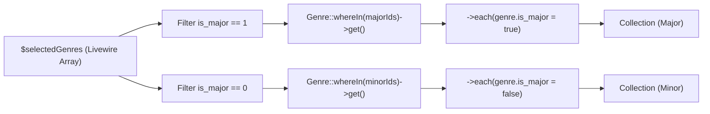

# Requirements

### Overview & Goals
The goal of this change is to preserve and attach the `is_major` flag from the Livewire component's `$selectedGenres` array onto the Eloquent `Genre` models returned by the `majorGenres()` (and `minorGenres()`) computed properties in `resources/views/pages/admin/manuscripts/⚡create.blade.php`.

### Scope
- **In Scope**:
  - Updating the `majorGenres()` computed property in `resources/views/pages/admin/manuscripts/⚡create.blade.php` to filter for major selections and attach `$genre->is_major` onto each returned `Genre` model instance.
  - Updating `minorGenres()` in `resources/views/pages/admin/manuscripts/⚡create.blade.php` to safely handle value parsing and attach `$genre->is_major` onto each returned `Genre` model instance.
  - Adding helper/normalization logic to handle both nested array values (`['is_major' => '1']` / `['is_major' => 1]`) and string values (`'major'` / `'minor'`) safely.
  - Updating and expanding Pest tests in `tests/Feature/Admin/Manuscripts/ManuscriptCreateGenreTest.php`.
- **Out of Scope**:
  - Altering database schema or migrations for `mss_genres` or `genres`.
  - Modifying backend persistence actions for manuscripts outside of component state.

### User Stories
- **As a Cataloguer**, I want selected genres in the manuscript creation wizard to clearly reflect whether they are marked as Major or Minor genres so that catalog metadata is displayed and processed accurately.
- **As a Developer**, I want the `majorGenres()` computed property to return `Genre` Eloquent models containing the `is_major` attribute so downstream view rendering and form processing can inspect this flag directly.

### Functional Requirements
- **FR-1**: Calling `$this->majorGenres` must return an `\Illuminate\Database\Eloquent\Collection` containing only genres where `is_major` is truthy in `$selectedGenres`.
- **FR-2**: Each `Genre` model in the collection returned by `$this->majorGenres` must have the attribute `$genre->is_major === true`.
- **FR-3**: Calling `$this->minorGenres` must return an `\Illuminate\Database\Eloquent\Collection` containing only genres where `is_major` is falsy in `$selectedGenres`.
- **FR-4**: Each `Genre` model in the collection returned by `$this->minorGenres` must have the attribute `$genre->is_major === false`.
- **FR-5**: If `$selectedGenres` is empty or no matching genres exist, both computed properties must return an empty `\Illuminate\Database\Eloquent\Collection`.

# Technical Design

### Current Implementation
In `resources/views/pages/admin/manuscripts/⚡create.blade.php`:
- `$selectedGenres` holds an associative array of selections keyed by Genre ID:
  ```php
  [
      'genre-uuid-1' => ['is_major' => '1'],
      'genre-uuid-2' => ['is_major' => '0'],
  ]
  ```
- The current `majorGenres` computed property executes:
  ```php
  #[Computed]
  public function majorGenres(): \Illuminate\Database\Eloquent\Collection
  {
      return empty($this->selectedGenres)
          ? new \Illuminate\Database\Eloquent\Collection()
          : Genre::whereIn('id', array_keys($this->selectedGenres))->get(['id', 'name']);
  }
  ```
  This has two problems:
  1. It fetches all selected genres without filtering for `is_major`.
  2. The resulting `Genre` models do not have the `is_major` property populated from `$this->selectedGenres`.

### Key Decisions
1. **Dynamic Attribute Binding on Eloquent Models**:
   - *Decision*: Iterate over the fetched collection using `->each(...)` to set `$genre->is_major = true` (or `false` for minor genres).
   - *Rationale*: Preserves the `\Illuminate\Database\Eloquent\Collection` return type while attaching `is_major` as a dynamic model attribute accessible in views and tests via `$genre->is_major`.

2. **Filtering by `is_major` Status**:
   - *Decision*: Extract IDs using `array_filter($this->selectedGenres, ...)` prior to executing `Genre::whereIn('id', $ids)`.
   - *Rationale*: Minimizes database query payload by only requesting relevant records for each computed property.

3. **Defensive Value Extraction**:
   - *Decision*: Support both array format `['is_major' => '1']` / `['is_major' => 1]` / `['is_major' => true]` and scalar format `'major'` / `'minor'` / `true` / `false`.
   - *Rationale*: Ensures resilience against varied test fixtures and Livewire wire:model serialization formats without throwing PHP string offset errors.

### Proposed Changes

#### 1. `resources/views/pages/admin/manuscripts/⚡create.blade.php`
Update `majorGenres()` and `minorGenres()`:
```php
#[Computed]
public function majorGenres(): \Illuminate\Database\Eloquent\Collection
{
    $majorIds = array_keys(array_filter($this->selectedGenres, function ($value) {
        if (is_array($value)) {
            return !empty($value['is_major']) && (string) $value['is_major'] !== '0';
        }
        return $value === 'major' || $value === true || $value === 1 || $value === '1';
    }));

    if (empty($majorIds)) {
        return new \Illuminate\Database\Eloquent\Collection();
    }

    return Genre::whereIn('id', $majorIds)
        ->get(['id', 'name'])
        ->each(function (Genre $genre) {
            $genre->is_major = true;
        });
}

#[Computed]
public function minorGenres(): \Illuminate\Database\Eloquent\Collection
{
    $minorIds = array_keys(array_filter($this->selectedGenres, function ($value) {
        if (is_array($value)) {
            return isset($value['is_major']) && ((string) $value['is_major'] === '0' || $value['is_major'] === false);
        }
        return $value === 'minor' || $value === false || $value === 0 || $value === '0';
    }));

    if (empty($minorIds)) {
        return new \Illuminate\Database\Eloquent\Collection();
    }

    return Genre::whereIn('id', $minorIds)
        ->get(['id', 'name'])
        ->each(function (Genre $genre) {
            $genre->is_major = false;
        });
}
```

### Architecture Diagram



### File Structure
- `resources/views/pages/admin/manuscripts/⚡create.blade.php` *(modified)*
- `tests/Feature/Admin/Manuscripts/ManuscriptCreateGenreTest.php` *(modified)*

# Testing

### Validation Approach
Automated Pest feature tests will verify that `majorGenres` and `minorGenres` correctly filter selected genres and attach the `is_major` boolean attribute to each Eloquent model in the returned collections.

### Key Scenarios
1. **Major Genres Filter & Attribute Attachment**:
   - Given `$selectedGenres` containing one major genre (`['is_major' => '1']`) and one minor genre (`['is_major' => '0']`).
   - When `$this->majorGenres` is accessed.
   - Then it contains only the major genre model and `$genre->is_major` is `true`.

2. **Minor Genres Filter & Attribute Attachment**:
   - Given `$selectedGenres` containing one major genre and one minor genre.
   - When `$this->minorGenres` is accessed.
   - Then it contains only the minor genre model and `$genre->is_major` is `false`.

3. **Empty Selections**:
   - Given `$selectedGenres` is `[]`.
   - When `$this->majorGenres` and `$this->minorGenres` are accessed.
   - Then both return empty `\Illuminate\Database\Eloquent\Collection` instances.

4. **Component Interaction & Removal**:
   - Calling `removeGenre(id)` updates `$selectedGenres` and causes `majorGenres` and `minorGenres` to recompute correctly.

### Test Changes
- Update `tests/Feature/Admin/Manuscripts/ManuscriptCreateGenreTest.php` with dedicated test cases for `majorGenres` and `minorGenres` computed properties asserting model attributes and collection contents.

# Delivery Steps

###   Step 1: Implement is_major preservation and filtering in majorGenres computed property
Update `majorGenres()` and `minorGenres()` in `resources/views/pages/admin/manuscripts/⚡create.blade.php` to filter by major/minor status and attach the `is_major` property onto each Eloquent `Genre` model in the returned collection.

- Filter the IDs queried in `majorGenres()` to only include selected genres where `is_major` is true (handling array entries `['is_major' => '1']` / `['is_major' => 1]` / `['is_major' => true]` as well as legacy scalar values `'major'`).
- Query `Genre::whereIn('id', $majorGenreIds)->get(['id', 'name'])` and chain `->each()` / `->transform()` to set `$genre->is_major = true` on each model instance.
- Update `minorGenres()` to safely filter for minor genres (`is_major` is false / 0 / 'minor') without throwing string offset errors and attach `$genre->is_major = false` on each model instance.
- Ensure the return types remain `\Illuminate\Database\Eloquent\Collection`.

###   Step 2: Add Pest tests for majorGenres and minorGenres computed properties
Add and update automated Pest feature tests in `tests/Feature/Admin/Manuscripts/ManuscriptCreateGenreTest.php` to verify that `majorGenres` and `minorGenres` return the expected models with `is_major` correctly populated and cast.

- Add test asserting `majorGenres` returns only major genres and includes the `is_major` property set to `true`.
- Add test asserting `minorGenres` returns only minor genres and includes the `is_major` property set to `false`.
- Update existing test payloads to use the standard `['is_major' => '1']` / `['is_major' => '0']` structure used by `⚡genre-select.blade.php`.
- Run tests via `php artisan test --filter=ManuscriptCreateGenreTest` and apply formatting via Laravel Pint.